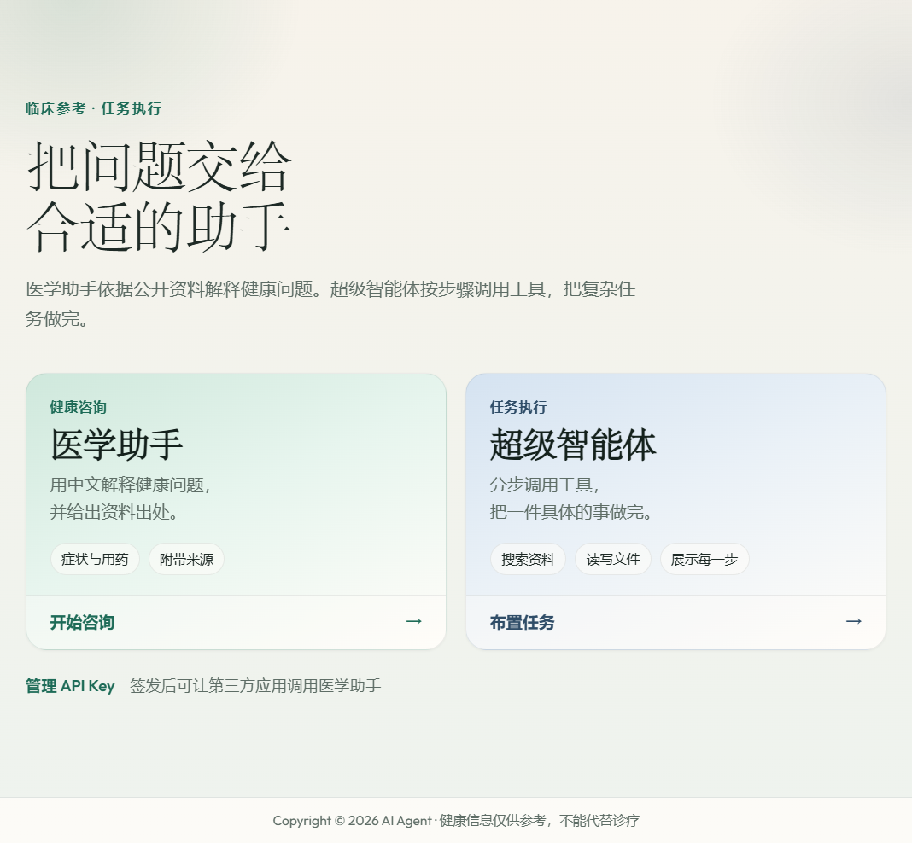
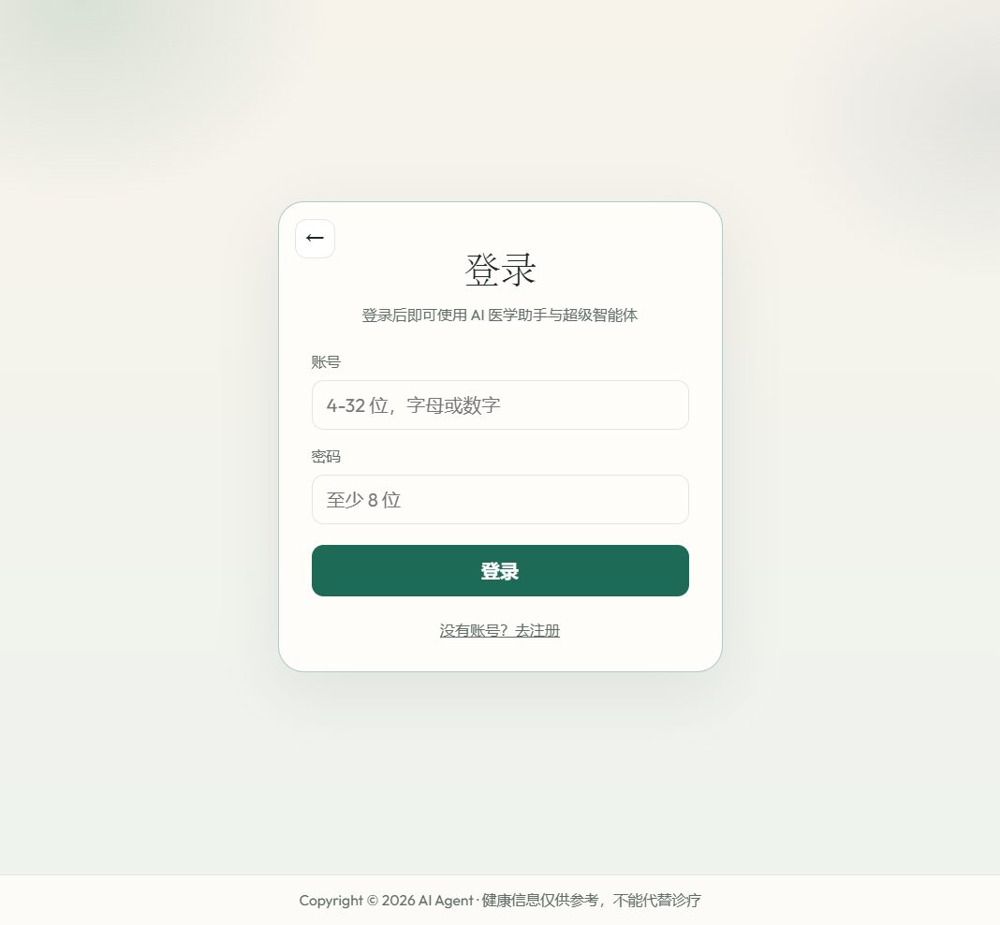
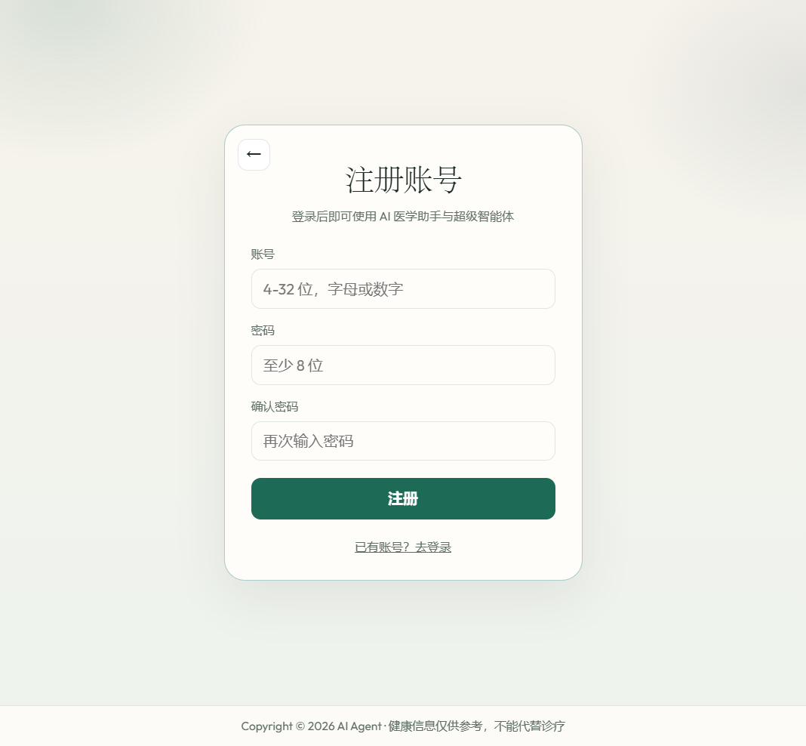
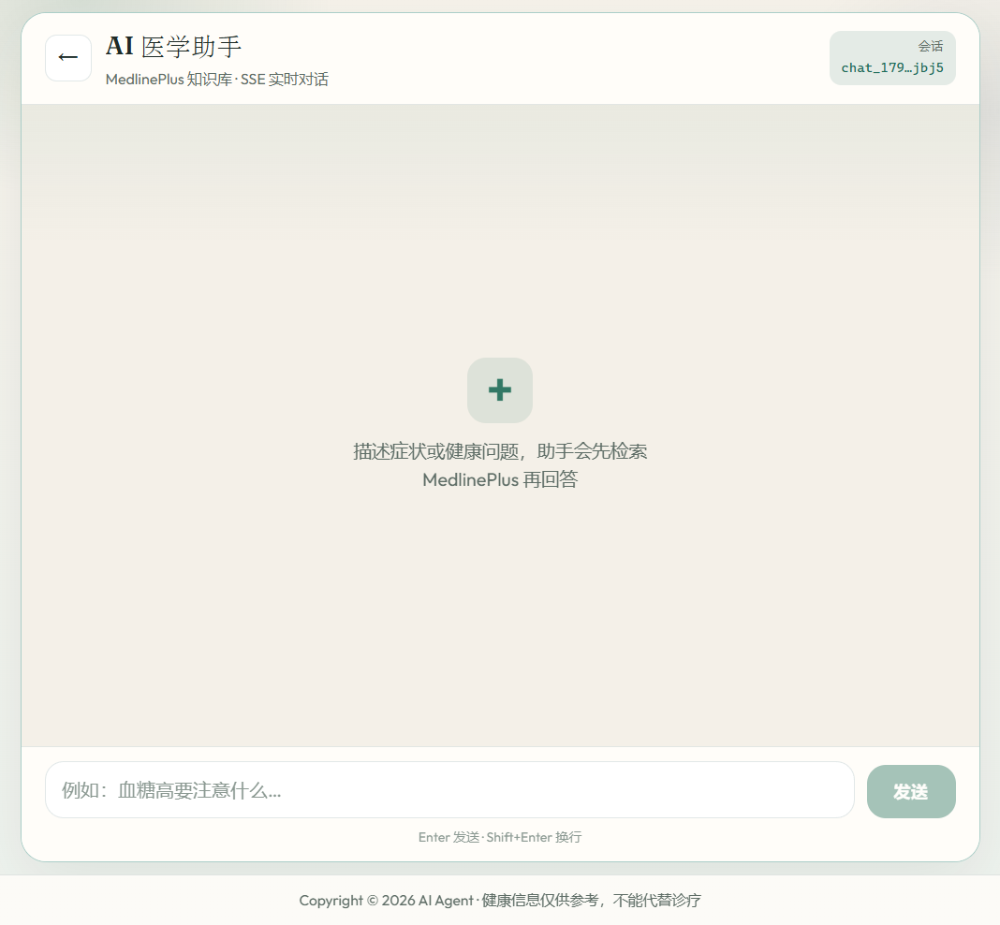
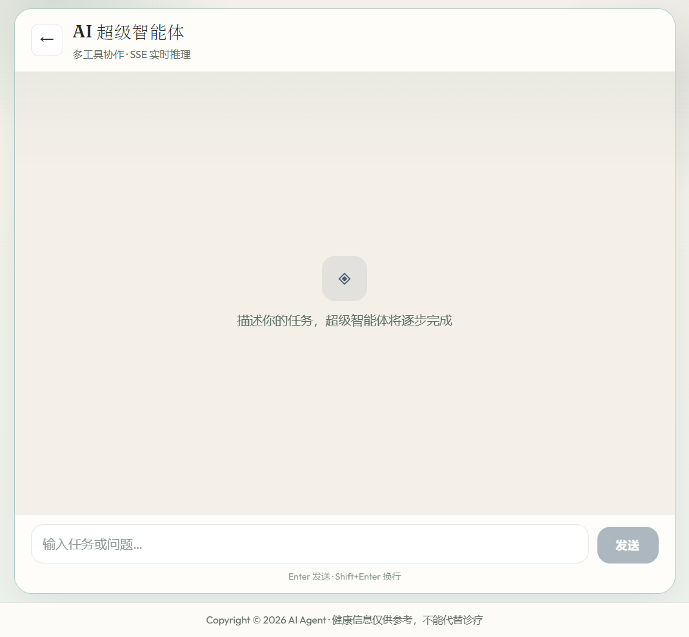
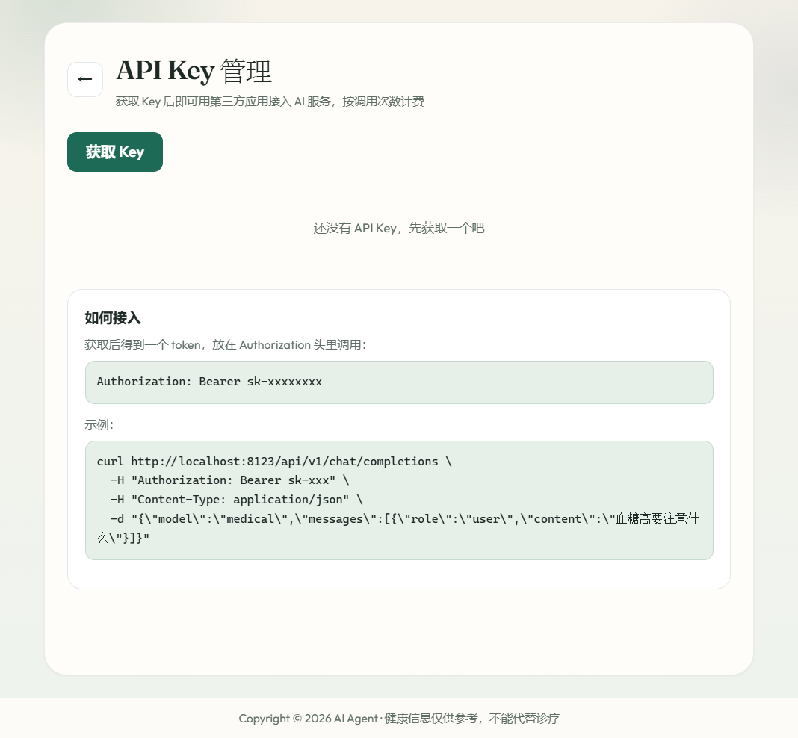
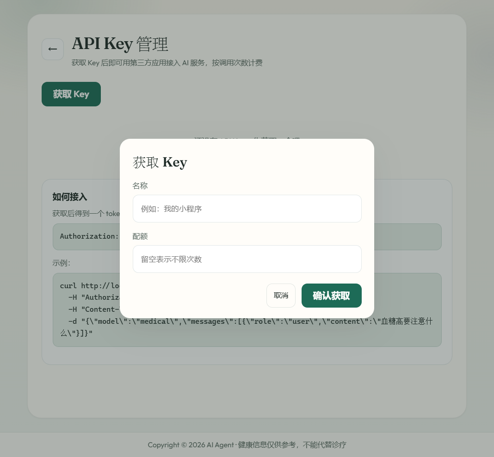
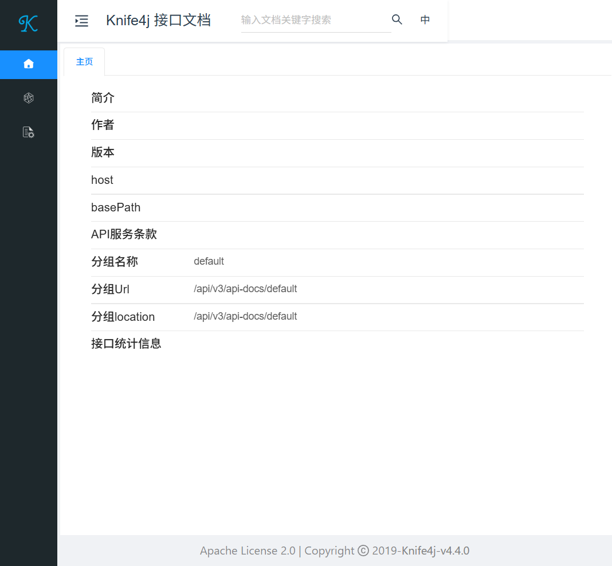

# AI Agent 项目说明

这是一个带网页的智能体应用。用户登录后可以使用两个助手：医学助手根据 MedlinePlus 公开资料用中文解释健康问题，并在回答里附上资料标题和链接；超级智能体按步骤调用搜索、文件和终端等工具，把过程展示在页面上。另外提供 API Key，让第三方程序用类似 OpenAI 的接口调用医学助手。

后端是 Java 21 和 Spring Boot，对话模型用 DeepSeek，向量和重排用通义千问。前端是 Vue 3 和 Vite。用户、API Key 和任务记录存在 PostgreSQL。医学资料的向量索引写在本地 JSON 文件里，不使用 pgvector。

## 页面

网站有这些页面：首页、登录、注册、医学助手、超级智能体、API Key 管理，以及后端的 Knife4j 接口文档。登录和注册是同一个地址，用页面底部的链接切换。

### 首页

地址：`http://localhost:5173/`

登录后进入应用中心，从这里进入医学助手、超级智能体或 API Key 管理。未登录时访问首页会被送到登录页。



### 登录

地址：`http://localhost:5173/login`

账号为 4 到 32 位字母或数字，密码至少 8 位。登录成功后回到原本要打开的页面。



### 注册

注册和登录共用 `/login`。注册成功后回到登录表单，再输入密码登录。



### 医学助手

地址：`http://localhost:5173/love-app`

输入症状或健康问题后，后端先检索 MedlinePlus，再把命中的段落放进系统提示词，由 DeepSeek 用中文流式回答。页面提示回答会附带来源。这里不做诊断、不开药。



### 超级智能体

地址：`http://localhost:5173/manus-app`

用户描述一项任务后，智能体分步思考，并由应用自己执行搜索、读写文件和终端命令。每一步的调用和结果会通过 SSE 推到页面。停止任务时写入内存标志，在下一步开始前停住，已经发出的模型请求不会被中途掐断。



### API Key 管理

地址：`http://localhost:5173/api-key`

登录后可以获取 Key、查看已用配额，以及禁用或删除已有 Key。明文 token 只在创建成功时出现一次，数据库里只保存它的 SHA-256 摘要。配额留空表示不限次数，成功调用才会扣减。



点击「获取 Key」后弹出窗口，填写名称和配额。



第三方这样调用医学助手：

```bash
curl http://localhost:8123/api/v1/chat/completions \
  -H "Authorization: Bearer sk-xxx" \
  -H "Content-Type: application/json" \
  -d "{\"model\":\"medical\",\"messages\":[{\"role\":\"user\",\"content\":\"血糖高要注意什么\"}]}"
```

`model` 只接受 `medical` 或 `medical-assistant`。`stream` 为 true 时按 SSE 返回，结束时带 `data: [DONE]`。

### 接口文档

地址：`http://localhost:8123/api/doc.html`

Knife4j 列出后端接口，本地调试时使用。生产环境应把 `KNIFE4J_PRODUCTION` 设为 `true`，关掉文档页。



## 医学助手如何检索

资料是 `src/main/resources/document/medlineplus` 下的英文 Markdown。建索引时按小节切开，大约 900 字一块，短于 80 字的块丢掉。同一小节被截成多块时，后面每一块开头仍带着该小节标题。

中文问题会先改写成一句英文问句和一组英文关键词。问句做向量检索，关键词做内存 BM25。两路各取 20 段，用 RRF 合并后再用通义重排，按标题去重后留下 4 段，写进系统提示词。

向量存在 `data/medical-vector-store-v4.json`。这个文件已在 `.gitignore` 中。`application.yaml` 里 `app.medical-rag.rebuild` 为 `false` 且文件存在时，启动后直接加载，不再重新调用向量接口。改过 Markdown 后，把 `rebuild` 设为 `true` 再启动一次。

## 本地运行

1. 安装 JDK 21、Node.js 和 PostgreSQL，并建好数据库 `agent`。
2. 把 `.env.example` 复制为项目根目录的 `.env`，填入数据库地址、DeepSeek、通义千问和搜索接口的密钥。`.env` 不会进入 Git。
3. 启动后端。默认端口 `8123`，接口前缀是 `/api`。

```powershell
& 'E:\apache-maven-3.9.5\bin\mvn.cmd' spring-boot:run
```

4. 启动前端，开发地址是 `http://localhost:5173`。`/api` 会代理到后端。

```powershell
Set-Location F:\idea_projects\ai-agent\ai-agent-frontend
npm install
npm run dev
```

第一次打开医学助手时，如果本地还没有向量索引，会调用通义向量接口生成 `data/medical-vector-store-v4.json`。
